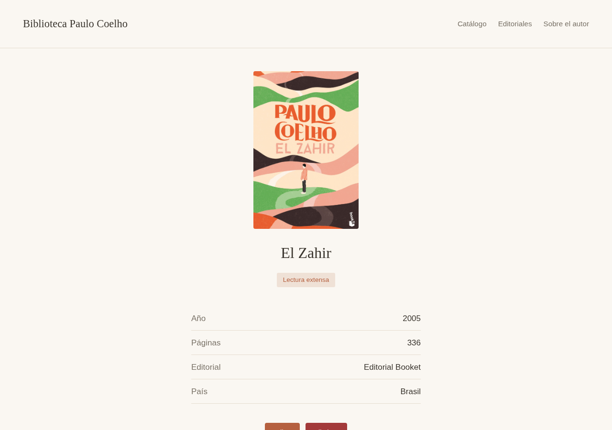
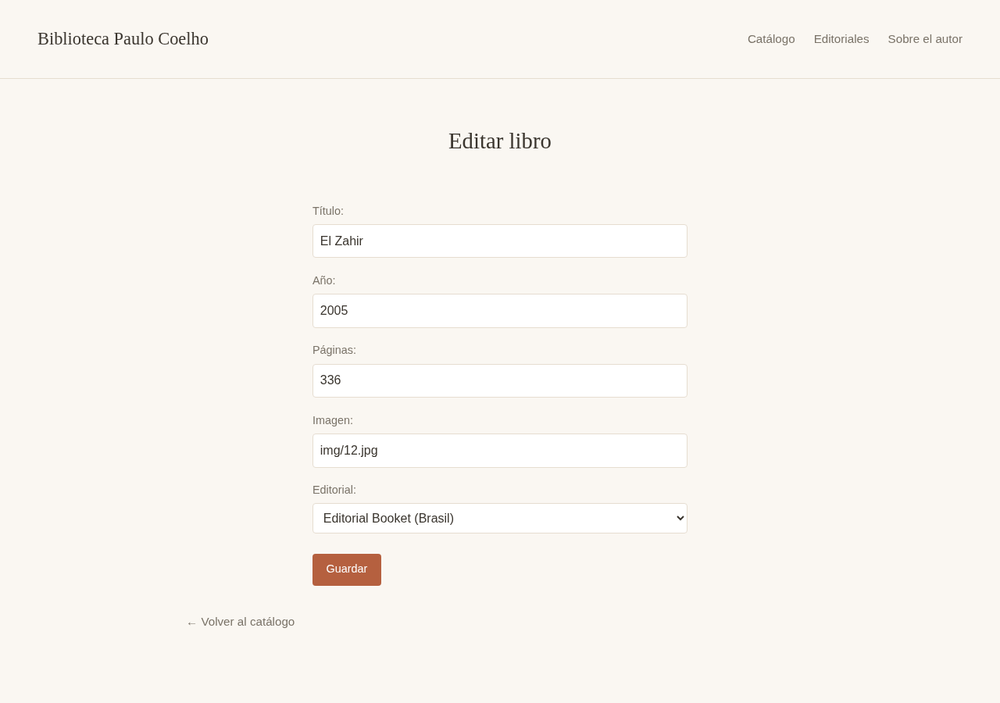
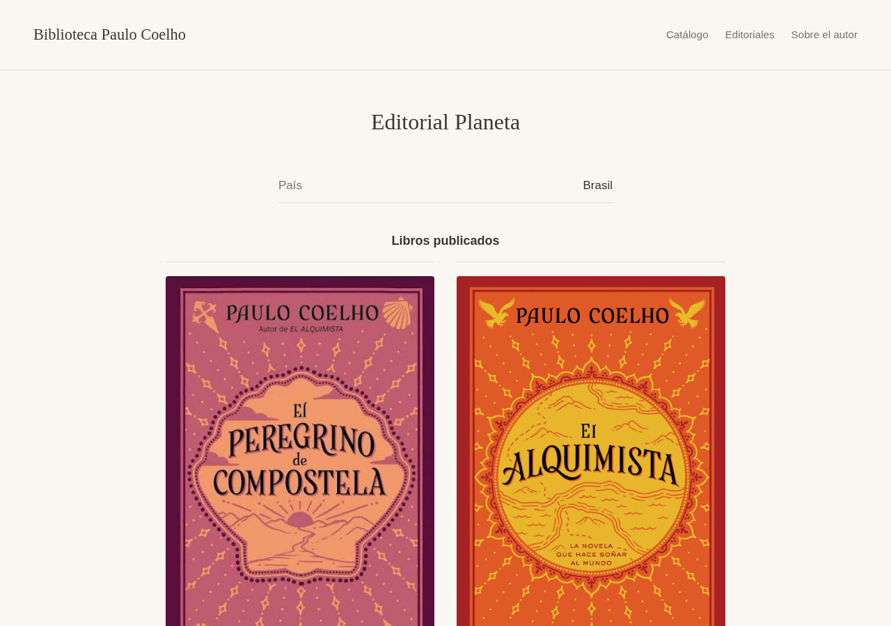
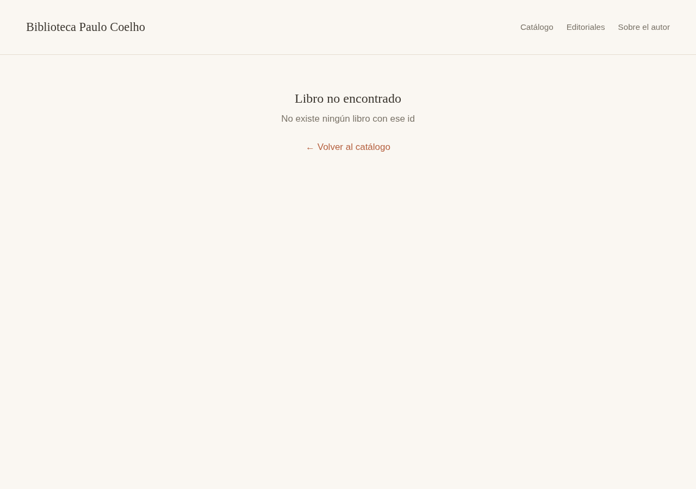

# 📚 Biblioteca Paulo Coelho — Frontend

Interfaz web hecha con **Next.js**, **React** y **Tailwind CSS** para consultar y administrar el catálogo de libros de Paulo Coelho. Es **solo el frontend**: todos los datos vienen de una API REST en Django conectada a MongoDB Atlas.

> 🔗 **La API (backend) está aquí:** [github.com/Tomaxus/Libreria-REST](https://github.com/Tomaxus/Libreria-REST.git)

<p>
  
  
  
  
  
  
</p>

## ✨ Vista previa

<table>
  <tr>
    <td align="center" width="50%">
      <br>
      <sub>Catálogo</sub>
    </td>
    <td align="center" width="50%">
      <br>
      <sub>Detalle de un libro</sub>
    </td>
  </tr>
  <tr>
    <td align="center" width="50%">
      <br>
      <sub>Editar libro</sub>
    </td>
    <td align="center" width="50%">
      <br>
      <sub>Editorial y sus libros</sub>
    </td>
  </tr>
  <tr>
    <td align="center" width="50%">
      <br>
      <sub>Sobre el autor</sub>
    </td>
    <td align="center" width="50%">
      <br>
      <sub>Libro no encontrado (404 de la API)</sub>
    </td>
  </tr>
</table>

## 🧱 Tecnologías

### Frontend (este repositorio)

| Tecnología | Versión | Para qué se usa |
|---|---|---|
| **Next.js** | 16.3 | Framework de React con App Router: cada carpeta dentro de `src/app` es una ruta. Compila con **Turbopack**. |
| **React** | 19.2 | Componentes, estado (`useState`) y efectos (`useEffect`) para consumir la API. |
| **TypeScript** | 5.9 | Tipos para los libros, las editoriales y las respuestas de la API. |
| **Tailwind CSS** | 4.3 | Estilos con clases utilitarias. La paleta del proyecto está definida en `globals.css` con `@theme`. |
| **ESLint** | 9 | Revisión del código con la configuración oficial de Next.js. |
| **next/image** | — | Portadas y foto del autor. |

### Backend ([Libreria-REST](https://github.com/Tomaxus/Libreria-REST.git))

| Tecnología | Para qué se usa |
|---|---|
| **Python + Django 6.1** | Servidor de la API. |
| **Django REST Framework** | Endpoints REST, serializadores y validación. |
| **MongoDB Atlas** + `django-mongodb-backend` | Base de datos en la nube. |
| **drf-spectacular** | Documentación con Swagger y Redoc. |

## 🔌 Cómo se conecta con la API

El backend no tiene CORS configurado, así que el navegador **no** llama directamente a Django. Next.js funciona como proxy con un *rewrite* en `next.config.ts`:

```text
Navegador ──► localhost:3000/api/libros ──► Next.js ──► 127.0.0.1:8000/api/libros/ (Django)
```

Así no hay que modificar el backend. Next también agrega la barra final (`/`) que Django exige en las rutas.

Todas las llamadas a la API están en `src/lib/api.ts`:

| Función | Método | Endpoint |
|---|---|---|
| `listarLibros()` | `GET` | `/api/libros/` |
| `obtenerLibro(id)` | `GET` | `/api/libros/{id}/` |
| `crearLibro(datos)` | `POST` | `/api/libros/` |
| `editarLibro(id, datos)` | `PUT` | `/api/libros/{id}/` |
| `eliminarLibro(id)` | `DELETE` | `/api/libros/{id}/` |
| `listarEditoriales()` | `GET` | `/api/editoriales/` |
| `obtenerEditorial(id)` | `GET` | `/api/editoriales/{id}/` |

Cómo se manejan las respuestas de error:

- **404**: muestra la página de "Libro no encontrado" o "Editorial no encontrada".
- **400**: los errores de validación de la API aparecen debajo de cada campo del formulario.
- **API apagada**: aparece un aviso para revisar que el backend esté corriendo.

## 🗂️ Estructura

```text
src/
├── app/                        rutas (App Router)
│   ├── layout.tsx              encabezado, navegación y estructura común
│   ├── globals.css             Tailwind + paleta de colores y tipografía
│   ├── page.tsx                redirige a /libros
│   ├── not-found.tsx           página 404
│   └── libros/
│       ├── page.tsx            catálogo
│       ├── nuevo/              crear libro
│       ├── autor/              sobre Paulo Coelho
│       ├── [id]/               detalle, editar/ y eliminar/
│       └── editoriales/        listado y [id]/ detalle
├── components/                 LibroCard, Portada, Ficha, FormularioLibro, ...
└── lib/
    ├── api.ts                  cliente de la API REST
    └── useApi.ts               hook para cargar datos (cargando / listo / error)
public/img/                     portadas de los libros y foto del autor
evidencias/                     capturas del proyecto
```

## 🔗 Rutas

| Ruta | Descripción |
|---|---|
| `/` | Redirige al catálogo |
| `/libros` | Muestra todos los libros |
| `/libros/nuevo` | Formulario para crear un libro |
| `/libros/{id}` | Detalle de un libro, marcado como *lectura rápida* (menos de 250 páginas) o *lectura extensa* |
| `/libros/{id}/editar` | Editar un libro |
| `/libros/{id}/eliminar` | Confirmar la eliminación |
| `/libros/editoriales` | Editoriales registradas |
| `/libros/editoriales/{id}` | Editorial y sus libros publicados |
| `/libros/autor` | Información sobre Paulo Coelho |

## 🚀 Instalación y ejecución

**1. Levanta el backend.** Sigue las instrucciones de [Libreria-REST](https://github.com/Tomaxus/Libreria-REST.git). Debe quedar corriendo en `http://127.0.0.1:8000`:

```bash
python manage.py runserver
```

**2. Instala las dependencias del frontend:**

```bash
npm install
```

**3. Inicia el servidor de desarrollo:**

```bash
npm run dev
```

**4. Abre** [http://localhost:3000](http://localhost:3000).

Si la API corre en otra dirección, crea un archivo `.env.local`:

```env
API_URL=http://127.0.0.1:8000
```

### Otros comandos

| Comando | Qué hace |
|---|---|
| `npm run build` | Genera la versión de producción |
| `npm start` | Sirve la versión de producción |
| `npm run lint` | Revisa el código con ESLint |

## 👤 Autor

Tomás Uribe Sánchez<br>
Estudiante de Ingeniería de Sistemas e Informática<br>
Universidad Pontificia Bolivariana
