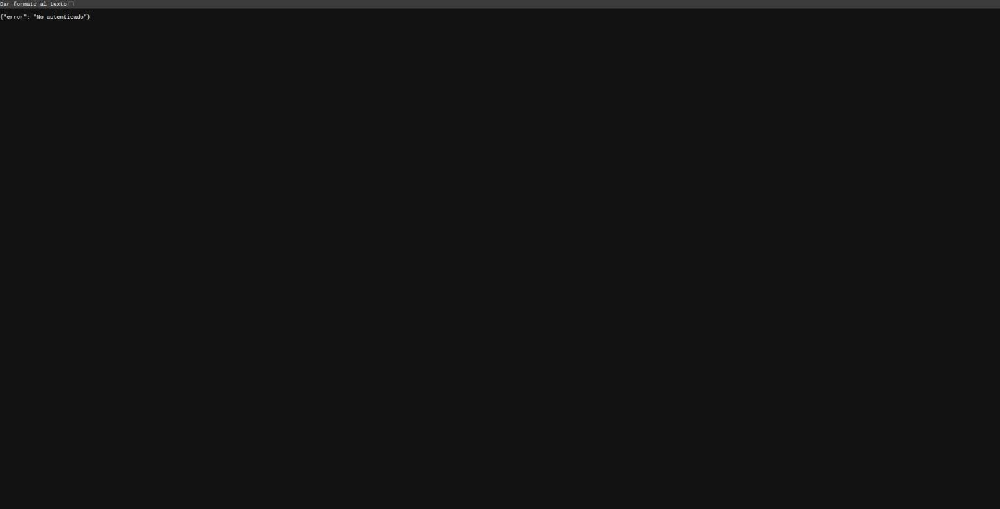

# Informe de seguridad

**Estudiantes:** Tomás Uribe Sánchez, Nicolás Rodríguez Acevedo
**Proyecto:** Backend Django + MongoDB Atlas (`Backend/`) y Frontend Next.js (`Frontend/`)
**Rama:** `seguridad`

## Parte 0 — Diagnóstico

| Pregunta | Respuesta |
|---|---|
| ¿Contraseñas guardadas tal cual? | No aplica (no hay usuarios) |
| ¿Credenciales en el código? | Sí: `SECRET_KEY` en `settings.py` |
| ¿Archivos de secretos en git? | No: `.env` está ignorado |
| ¿Texto de usuarios mostrado como HTML? | No |
| ¿Ver recursos de otro usuario cambiando el id? | No aplica |
| ¿Rutas de admin solo ocultas en el frontend? | Sí: crear, editar y borrar no piden login |
| ¿CORS abierto a cualquier origen? | Sí: `CORS_ALLOW_ALL_ORIGINS = True` |
| ¿Usa HTTP simple? | Sí |

En `settings.py`: `DEBUG = True`, `ALLOWED_HOSTS` vacío y `SECRET_KEY` escrita en el archivo.

`python manage.py check --deploy` al inicio: **7 problemas**.

## Hallazgos

| # | Hallazgo | OWASP | Evidencia | Corrección | Estado |
|---|---|---|---|---|---|
| 1 | `SECRET_KEY` en el código | A04 | `settings.py`, aviso W009; estaba en el historial de git | Se lee del `.env` y se generó una nueva (rotada) | Corregido |
| 2 | Crear/editar/borrar sin login | A01 | `AllowAny` en la API | Rutas de escritura solo para `admin` con `@autenticado(rol="admin")` | Corregido |
| 3 | CORS abierto | A02 | Respuesta con `access-control-allow-origin: *` | Solo `https://localhost:3000` | Corregido |
| 4 | `DEBUG = True` | A02 | `settings.py`, aviso W018 | Se lee del `.env`; errores JSON genéricos | Corregido |
| 5 | Sin HTTPS | A04 | Se abría con `http://` | HTTPS con mkcert | Corregido |
| 6 | `ALLOWED_HOSTS` vacío | A02 | Aviso W020 | `['localhost', '127.0.0.1']` | Corregido |
| 7 | Sin login ni límite de intentos | A07 | No hay usuarios | Registro con hash, login con JWT en cookie y límite de 5 intentos | Corregido |
| 8 | XSS almacenado en reseñas (al crearlas) | A05 | `alert('XSS')` con `dangerouslySetInnerHTML` | Texto escapado por React + CSP con nonce | Corregido |
| 9 | API de escritura sin protección CSRF (`csrf_exempt` de DRF) | A01 | `POST`/`DELETE` sin `X-CSRFToken` → 201/204 | Comprobación CSRF en `@autenticado` + `SameSite=Strict` | Corregido |
| 10 | Dependencias con vulnerabilidades conocidas (Next.js crítica, Django, pymongo, python-dotenv) | A03 | `pip-audit`: 8; `npm audit`: 4 (1 crítica) | Paquetes actualizados | Corregido |

## Parte 1 — HTTPS

Se generó un certificado local con mkcert. El backend corre en `https://localhost:8443` y el frontend en `https://localhost:3000`, con candado.

Chrome indica «La conexión es segura» (certificado de mkcert de confianza):

**¿Qué garantías da HTTPS que HTTP no da? ¿Garantiza que el sitio sea honesto?**
Da **cifrado** (nadie puede leer los datos en el camino) e **integridad** (nadie puede cambiarlos, y el certificado confirma el dominio). No garantiza que el sitio sea honesto: una página falsa también puede tener candado.

## Parte 2 — Registro, login y límite de intentos

- **Registro** (`/api/auth/registro/`): valida correo y clave de mínimo 10 caracteres. La contraseña se guarda con hash PBKDF2 y el rol lo pone el servidor (siempre `cliente`).
- **Login** (`/api/auth/login/`): mensaje genérico «Usuario o contraseña incorrectos» y token JWT de 15 minutos en una cookie `HttpOnly`, `Secure` y `SameSite=Strict`.
- **Rutas protegidas**: crear, editar y borrar libros o editoriales exigen sesión; el catálogo sigue público.
- **Límite**: 5 intentos fallidos por IP cada 15 minutos; los fallos quedan registrados en la consola.
- **Frontend**: página `/cuenta` para registrarse, iniciar y cerrar sesión.

| Prueba | Resultado |
|---|---|
| Contraseña en la base de datos | `pbkdf2_sha256$1500000$...` (hash, no la clave) |
| Registro enviando `"rol": "admin"` | El usuario queda como `cliente` |
| Login correcto | 200 y cookie `token` con `HttpOnly` y `Secure` |
| Crear libro sin sesión | 401 |
| Sexto intento fallido | 429 |
| `document.cookie` en la consola | No aparece `token` |

**Evidencias**

Contraseña guardada como hash PBKDF2 en Atlas (usuario `cliente`, `is_staff: false`):

Página de cuenta:

Cookie `token` con `HttpOnly`, `Secure` y `SameSite=Strict`:

`document.cookie` no muestra el `token`:

Crear un libro sin sesión responde 401:

Sexto intento fallido bloqueado (429):

## Parte 3 — Roles y control de acceso

| Rol | Ver catálogo | Escribir reseñas | Crear/editar/borrar libros | Ver reseñas |
|---|---|---|---|---|
| Visitante | Sí | No | No | No |
| Cliente | Sí | Sí | No | Solo las suyas |
| Administrador | Sí | Sí | Sí | Todas |

- Crear, editar y borrar libros o editoriales exige `@autenticado(rol="admin")`. La verificación es en el servidor, no escondiendo botones.
- El administrador se crea desde `python manage.py shell` poniendo `is_staff = True`; no hay ningún endpoint público para hacerlo.
- **IDOR:** el proyecto no tenía recursos con dueño, así que se agregaron **reseñas** (`/api/resenas/`). Cada consulta filtra por el usuario del token y el dueño nunca se toma del cuerpo de la petición.

| Prueba | Resultado |
|---|---|
| Cliente hace `DELETE /api/libros/<id>` | 403 «Sin permiso» |
| Administrador crea y borra un libro | 201 y 204 |
| B pide la reseña de A | 404 (no revela que existe) |
| B intenta borrar la reseña de A | 404 |
| Administrador ve la reseña de A | 200 |

**Evidencias** (tomadas en Chrome)

Cliente intenta crear un libro → 403:

Administrador crea un libro → 201:

B pide la reseña de A → 404:

Administrador ve la reseña de A → 200:

## Parte 4 — XSS

- **Dónde:** el proyecto no tenía texto libre, así que se usaron las **reseñas** de la Parte 3, que se muestran en la página de cada libro.
- **Ataque:** primero se mostró la reseña con `dangerouslySetInnerHTML` y se publicó ``. Apareció la alerta: **XSS almacenado** (A05).
- **Corrección:** la reseña se muestra como texto (`
{r.texto}
`). React escapa el contenido y se ve el texto literal.
- **Refuerzo con CSP:** el frontend (Next) envía una `Content-Security-Policy` con un *nonce* distinto en cada petición (`src/proxy.ts`), además de `X-Content-Type-Options: nosniff` y `X-Frame-Options: DENY`. El backend también envía su CSP (`cuentas/middleware.py`).
- **Defensa en profundidad:** con la CSP activa se volvió a poner temporalmente el código vulnerable. La alerta ya no apareció: el navegador bloqueó el `onerror` en línea y lo reportó en la consola. Después se restauró la corrección.

| Prueba | Resultado |
|---|---|
| Código vulnerable sin CSP | Se ejecuta `alert('XSS')` |
| Código corregido | Se ve el texto literal, sin alerta |
| Código vulnerable con CSP | Sin alerta; error de CSP en la consola |

**Evidencias**

XSS almacenado antes de corregir:

Después de corregir, la reseña se ve como texto:

La CSP bloquea el `onerror` aunque el código sea vulnerable:

Cabeceras de seguridad en la respuesta:

## Parte 5 — CSRF

- **Hallazgo:** las vistas de Django REST vienen marcadas como `csrf_exempt`. Con la sesión de administrador, un `POST` y un `DELETE` **sin** la cabecera `X-CSRFToken` funcionaban (201 y 204).
- **Corrección:** `@autenticado` repite la comprobación CSRF de Django en todo método que modifica datos (la cookie `csrftoken` debe coincidir con la cabecera `X-CSRFToken` y el origen debe ser de confianza). Además `CSRF_COOKIE_SAMESITE = 'Strict'` y `CSRF_COOKIE_HTTPONLY = False`.
- **Frontend:** pide `/api/auth/csrf/` y envía `X-CSRFToken` en cada `POST`, `PUT` y `DELETE` (`lib/api.ts`).

| Prueba | Resultado |
|---|---|
| `POST` sin `X-CSRFToken` | 403 «Token CSRF inválido» |
| `POST` con token falso | 403 |
| `POST` con token correcto pero desde otro origen | 403 |
| `POST` / `DELETE` con token correcto | 201 / 204 |
| `ataque.html` servido desde `http://127.0.0.1:9000` con sesión de admin abierta | El navegador no envía la cookie (SameSite) → 401, no se crea nada |
| Crear un libro desde el frontend | Funciona |

**¿Por qué alguien pondría `@csrf_exempt` «porque da error 403» y por qué es mala idea?**
Porque el frontend no envía el token y el 403 «desaparece» al quitar la protección. Es mala idea porque cualquier página externa podría hacer peticiones con la sesión del usuario sin que él lo sepa. Lo correcto es enviar el token.

**Si ya usamos `SameSite=Strict`, ¿por qué se añade además el token?**
Por **defensa en profundidad**: navegadores antiguos no respetan `SameSite`, y un subdominio comprometido cuenta como el mismo sitio y sí recibiría la cookie. El token protege aunque falle la otra capa.

**Evidencias**

Página del atacante con la sesión de admin abierta → no se crea el libro:

Desde el frontend sí se crea:

## Parte 6 — Secretos, CORS, errores y dependencias

**Secretos**

- `SECRET_KEY`, `JWT_SECRET` y la URI de Atlas se leen del `.env`, que está en `.gitignore`. Se creó `Backend/.env.example` sin valores reales.
- La `SECRET_KEY` vieja estaba en el historial de git desde el primer commit, así que se **rotó** (se generó una nueva). La URI de Atlas nunca se subió (`git log --all -p -S"mongodb+srv"` solo muestra el ejemplo del README).
- Si falta una variable, el servidor no arranca y dice cuál: `ImproperlyConfigured: Falta la variable JWT_SECRET en el archivo .env`.

**CORS:** el frontend llega por el proxy de Next (mismo origen). Se quitó `CORS_ALLOW_ALL_ORIGINS` y solo se permite `https://localhost:3000`. Un origen externo ya no recibe `Access-Control-Allow-Origin`.

**Errores:** con `DEBUG=0` las respuestas son genéricas y el detalle queda en la consola del servidor. También se quitó la página navegable de Django REST.

| Prueba (`DEBUG=0`) | Resultado |
|---|---|
| Ruta inexistente | 404 `{"error": "No encontrado"}` |
| Id mal formado | 404 `{"error": "Libro no encontrado."}` |
| Host no permitido (`Host: evil.com`) | 400 sin detalle; la traza solo en la consola |
| Pedir la API como HTML | 406, ya no muestra la página navegable |

**Dependencias**

| Herramienta | Antes | Después |
|---|---|---|
| `pip-audit` | 8 vulnerabilidades: Django 6.1, pymongo 4.15.3 (5), python-dotenv 1.2.1 | 0 (Django 6.1.1, pymongo 4.18.3, python-dotenv 1.2.2) |
| `npm audit` | 4: **next 16.3.6 crítica** (ejecución remota de código, entre otras), sharp, source-map-js y zod altas | 0 (next 16.4.3 y `npm audit fix`) |
| `check --deploy` | 7 problemas | 2: `mail.E001` (correo de consola, la app no envía correos) y `W021` (HSTS preload, no aplica en localhost) |

**Atlas:** pendiente de revisar en el panel (Network Access y Database Access).

## Parte 7 — Auditoría OWASP Top 10 (2025)

| OWASP | Pregunta de revisión | Resultado | Dónde |
|---|---|---|---|
| A01 Control de acceso roto | ¿Cada ruta verifica rol y propietario en el servidor? | Sí: rol `admin` para escribir libros y reseñas filtradas por dueño; CSRF exigido | Partes 3 y 5 |
| A02 Configuración insegura | ¿CORS, DEBUG, Atlas y cabeceras están bien? | CORS limitado, `DEBUG` por `.env`, `ALLOWED_HOSTS`, CSP y cabeceras; Atlas pendiente de revisar | Partes 4 y 6 |
| A03 Cadena de suministro | ¿Se auditaron las dependencias? | Sí: `pip-audit` y `npm audit` en 0 | Parte 6.5 |
| A04 Fallas criptográficas | ¿HTTPS? ¿Hash lento? ¿Secretos fuera del código? | Sí: HTTPS, PBKDF2 y secretos en `.env` (clave rotada) | Partes 1, 2 y 6 |
| A05 Inyección (incluye XSS) | ¿Salida escapada y entradas validadas por tipo? | Sí: React escapa, CSP con nonce y los serializers validan tipos | Partes 2 y 4 |
| A06 Diseño inseguro | ¿Hay lógica que se pueda abusar? | Probado: valores negativos y campos de más son rechazados o ignorados | Parte 7.1 |
| A07 Fallas de autenticación | ¿Límite de intentos, mensajes genéricos, tokens con vencimiento? | Sí: 5 intentos, mensaje genérico y JWT de 15 min | Parte 2 |
| A08 Integridad de software o datos | ¿Token firmado? ¿Se confía en datos del cliente? | Token HS256 verificado; el rol y el dueño salen del servidor | Partes 2 y 3 |
| A09 Registros y alertas | ¿Se registran los logins fallidos y los errores? | Sí, en la consola del servidor (sin alertas automáticas) | Partes 2 y 6.4 |
| A10 Condiciones excepcionales | ¿Los errores fallan de forma segura? | Sí: token inválido → 401, sin rol → 403, error → respuesta genérica | Parte 6.4 |

### 7.1 Pruebas de diseño inseguro (A06)

La tienda de esta guía no tiene compras ni precios, así que se probaron los equivalentes del proyecto:

| Prueba | Resultado |
|---|---|
| Crear un libro con `"paginas": -5` | 400: «Ensure this value is greater than or equal to 0» |
| Crear un libro con `"anio": "abc"` | 400: «A valid integer is required» |
| Registro con `"rol": "admin", "is_staff": true` | El usuario queda como `cliente` |
| Reseña enviando otro `usuario` en el cuerpo | El dueño es el usuario del token, no el enviado |

### 7.2 Matriz de riesgos

| Riesgo que sigue presente | Probabilidad | Impacto | Tratamiento |
|---|---|---|---|
| El límite de intentos es por IP y todo pasa por el proxy de Next (misma IP): un atacante puede bloquear el login de todos | Media | Medio | Mitigar: contar por IP real (`X-Forwarded-For` de confianza) y por correo |
| El token no se puede revocar: tras cerrar sesión o quitar el rol sigue válido hasta 15 min | Media | Medio | Mitigar: lista de tokens revocados o tokens más cortos con renovación |
| Sin MFA para el administrador | Baja | Alto | Mitigar: agregar segundo factor a las cuentas `admin` |
| La caché del límite de intentos está en memoria: se reinicia con el servidor y no sirve con varios procesos | Media | Bajo | Mitigar: usar Redis en producción |
| Filtración de la cadena de Atlas desde el equipo de un desarrollador | Baja | Alto | Mitigar: usuario de mínimo privilegio, IP restringida y rotación |

### 7.3 Plan ante un incidente: filtración de la cadena de Atlas (ciclo NIST)

1. **Preparación:** secretos solo en `.env`, `.env.example` documentado, usuario de Atlas con `readWrite` sobre la base de la tienda y lista de IP permitidas.
2. **Detección:** alerta de GitHub *secret scanning* o aviso de Atlas por accesos desde IP desconocidas; revisar los registros de acceso del clúster.
3. **Contención:** cambiar de inmediato la contraseña del usuario de Atlas (o desactivarlo) y quitar de Network Access cualquier IP no conocida.
4. **Erradicación:** borrar el secreto del repositorio y de su historial (`git filter-repo`), y revisar si hay datos modificados o usuarios creados por el atacante.
5. **Recuperación:** poner la nueva cadena en el `.env`, restaurar desde un respaldo si hubo cambios y comprobar que la aplicación funciona.
6. **Lecciones aprendidas:** documentar qué pasó, activar *secret scanning* y un *hook* de pre-commit que bloquee secretos.

### 7.4 Datos personales (Ley 1581 de 2012)

La aplicación guarda del cliente su **correo** (que es también su usuario), el **hash de la contraseña**, la fecha de registro y el último acceso, y las **reseñas** que escribe. El correo y la contraseña son necesarios para iniciar sesión. Los campos `first_name` y `last_name` del modelo de Django están vacíos y no se usan, así que **no deberían recolectarse**. Si la tienda creciera, falta pedir la **autorización** del titular y publicar la política de tratamiento de datos, como exige la ley.

## Cierre

**¿Cuál fue el hallazgo más grave y por qué?**
Que cualquiera, sin iniciar sesión, podía crear, editar y borrar libros y editoriales (A01). No hacía falta ninguna técnica: bastaba con llamar a la API.

**¿Qué defensa habría evitado el caso de la clase que más nos impactó?**
Equifax: la brecha vino de una dependencia sin actualizar. La auditoría de dependencias de la Parte 6.5 (`pip-audit` y `npm audit`), hecha de forma periódica, habría detectado la versión vulnerable. En este laboratorio encontró una vulnerabilidad crítica en Next.js.

**¿Qué dejaríamos como mejora futura?**
MFA para administradores, renovación y revocación de tokens, límite de intentos con Redis por IP real y por correo, y pruebas automáticas de seguridad en cada *push* (`pip-audit`, `npm audit` y escaneo de secretos).
