# Informe de seguridad

**Estudiantes:** Tomás Uribe Sánchez, Nicolás Rodríguez Acevedo
**Proyecto:** Backend Django + MongoDB Atlas (`Backend/`) y Frontend Next.js (`Frontend/`)
**Rama:** `seguridad`

## Parte 0 — Diagnóstico

| Pregunta | Respuesta |
|---|---|
| ¿Contraseñas guardadas tal cual? | No aplica (no hay usuarios) |
| ¿Credenciales en el código? | Sí: `SECRET_KEY` en `settings.py` |
| ¿Archivos de secretos en git? | No: `.env` está ignorado |
| ¿Texto de usuarios mostrado como HTML? | No |
| ¿Ver recursos de otro usuario cambiando el id? | No aplica |
| ¿Rutas de admin solo ocultas en el frontend? | Sí: crear, editar y borrar no piden login |
| ¿CORS abierto a cualquier origen? | Sí: `CORS_ALLOW_ALL_ORIGINS = True` |
| ¿Usa HTTP simple? | Sí |

En `settings.py`: `DEBUG = True`, `ALLOWED_HOSTS` vacío y `SECRET_KEY` escrita en el archivo.

`python manage.py check --deploy` al inicio: **7 problemas**.

## Hallazgos

| # | Hallazgo | OWASP | Evidencia | Corrección | Estado |
|---|---|---|---|---|---|
| 1 | `SECRET_KEY` en el código | A04 | `settings.py`, aviso W009 | | Pendiente |
| 2 | Crear/editar/borrar sin login | A01 | `AllowAny` en la API | Rutas de escritura solo para `admin` con `@autenticado(rol="admin")` | Corregido |
| 3 | CORS abierto | A02 | Respuesta con `access-control-allow-origin: *` | | Pendiente |
| 4 | `DEBUG = True` | A02 | `settings.py`, aviso W018 | | Pendiente |
| 5 | Sin HTTPS | A04 | Se abría con `http://` | HTTPS con mkcert | Corregido |
| 6 | `ALLOWED_HOSTS` vacío | A02 | Aviso W020 | | Pendiente |
| 7 | Sin login ni límite de intentos | A07 | No hay usuarios | Registro con hash, login con JWT en cookie y límite de 5 intentos | Corregido |
| 8 | XSS almacenado en reseñas (al crearlas) | A05 | `alert('XSS')` con `dangerouslySetInnerHTML` | Texto escapado por React + CSP con nonce | Corregido |

## Parte 1 — HTTPS

Se generó un certificado local con mkcert. El backend corre en `https://localhost:8443` y el frontend en `https://localhost:3000`, con candado.

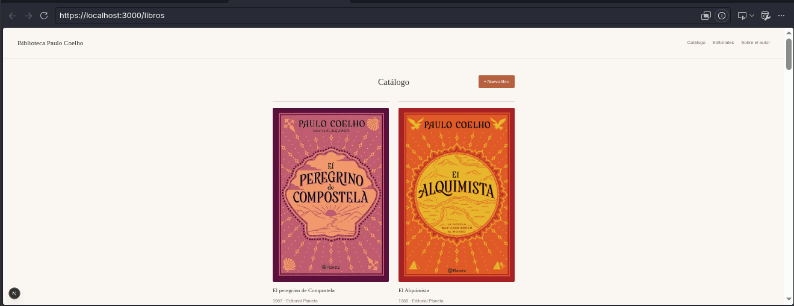

Chrome indica «La conexión es segura» (certificado de mkcert de confianza):
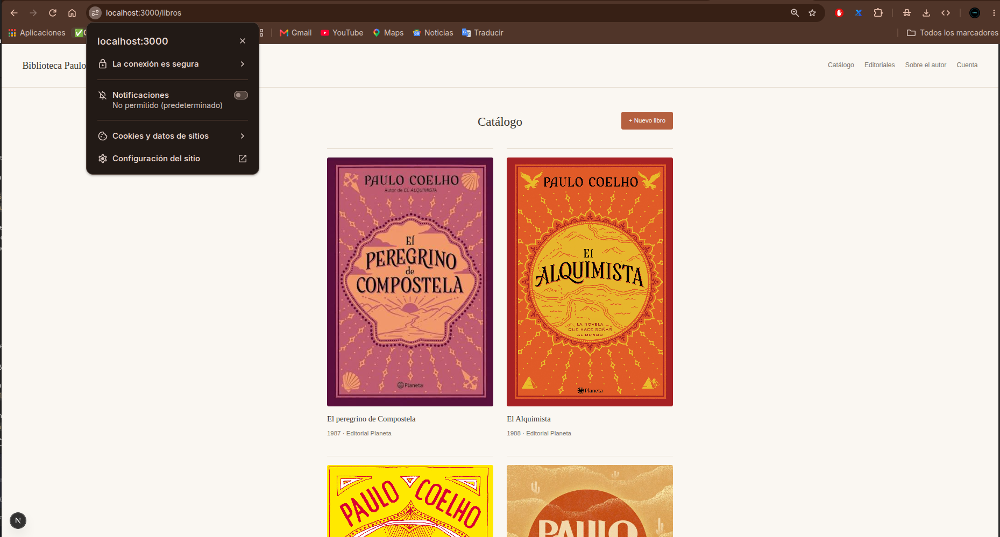

**¿Qué garantías da HTTPS que HTTP no da? ¿Garantiza que el sitio sea honesto?**
Da **cifrado** (nadie puede leer los datos en el camino) e **integridad** (nadie puede cambiarlos, y el certificado confirma el dominio). No garantiza que el sitio sea honesto: una página falsa también puede tener candado.

## Parte 2 — Registro, login y límite de intentos

- **Registro** (`/api/auth/registro/`): valida correo y clave de mínimo 10 caracteres. La contraseña se guarda con hash PBKDF2 y el rol lo pone el servidor (siempre `cliente`).
- **Login** (`/api/auth/login/`): mensaje genérico «Usuario o contraseña incorrectos» y token JWT de 15 minutos en una cookie `HttpOnly`, `Secure` y `SameSite=Strict`.
- **Rutas protegidas**: crear, editar y borrar libros o editoriales exigen sesión; el catálogo sigue público.
- **Límite**: 5 intentos fallidos por IP cada 15 minutos; los fallos quedan registrados en la consola.
- **Frontend**: página `/cuenta` para registrarse, iniciar y cerrar sesión.

| Prueba | Resultado |
|---|---|
| Contraseña en la base de datos | `pbkdf2_sha256$1500000$...` (hash, no la clave) |
| Registro enviando `"rol": "admin"` | El usuario queda como `cliente` |
| Login correcto | 200 y cookie `token` con `HttpOnly` y `Secure` |
| Crear libro sin sesión | 401 |
| Sexto intento fallido | 429 |
| `document.cookie` en la consola | No aparece `token` |

**Evidencias**

Contraseña guardada como hash PBKDF2 en Atlas (usuario `cliente`, `is_staff: false`):
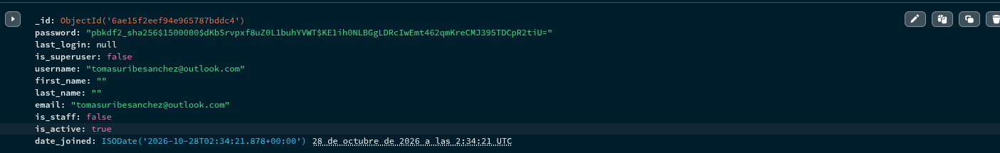

Página de cuenta:
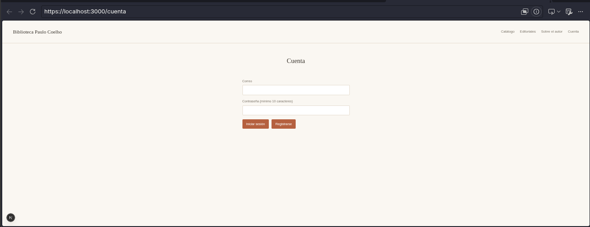

Cookie `token` con `HttpOnly`, `Secure` y `SameSite=Strict`:
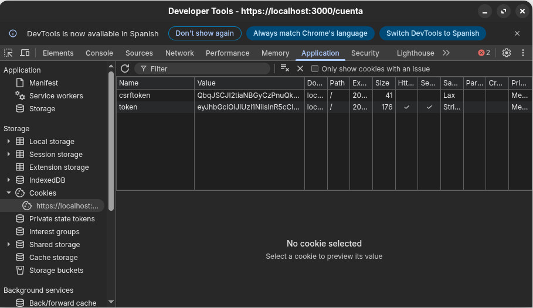

`document.cookie` no muestra el `token`:
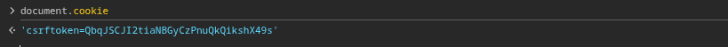

Crear un libro sin sesión responde 401:
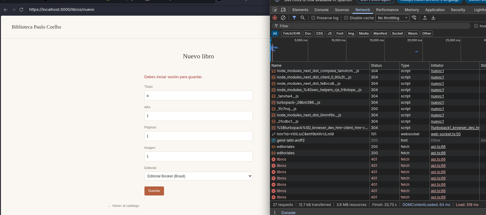

Sexto intento fallido bloqueado (429):
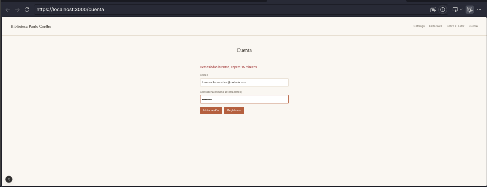

## Parte 3 — Roles y control de acceso

| Rol | Ver catálogo | Escribir reseñas | Crear/editar/borrar libros | Ver reseñas |
|---|---|---|---|---|
| Visitante | Sí | No | No | No |
| Cliente | Sí | Sí | No | Solo las suyas |
| Administrador | Sí | Sí | Sí | Todas |

- Crear, editar y borrar libros o editoriales exige `@autenticado(rol="admin")`. La verificación es en el servidor, no escondiendo botones.
- El administrador se crea desde `python manage.py shell` poniendo `is_staff = True`; no hay ningún endpoint público para hacerlo.
- **IDOR:** el proyecto no tenía recursos con dueño, así que se agregaron **reseñas** (`/api/resenas/`). Cada consulta filtra por el usuario del token y el dueño nunca se toma del cuerpo de la petición.

| Prueba | Resultado |
|---|---|
| Cliente hace `DELETE /api/libros/<id>` | 403 «Sin permiso» |
| Administrador crea y borra un libro | 201 y 204 |
| B pide la reseña de A | 404 (no revela que existe) |
| B intenta borrar la reseña de A | 404 |
| Administrador ve la reseña de A | 200 |

**Evidencias** (tomadas en Chrome)

Cliente intenta crear un libro → 403:
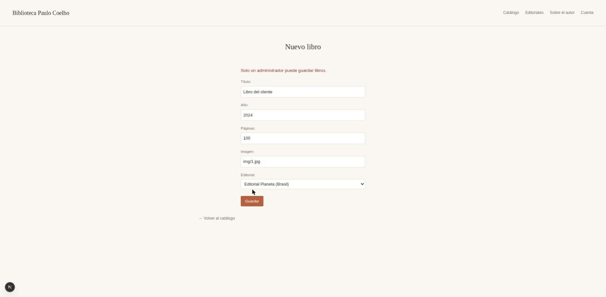

Administrador crea un libro → 201:
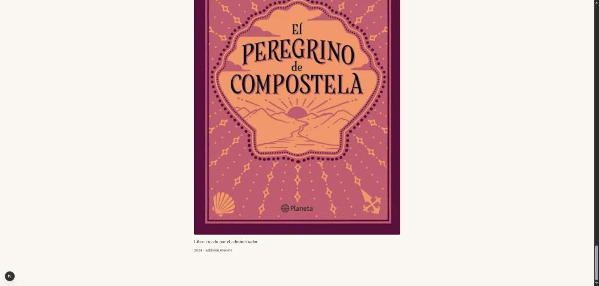

B pide la reseña de A → 404:
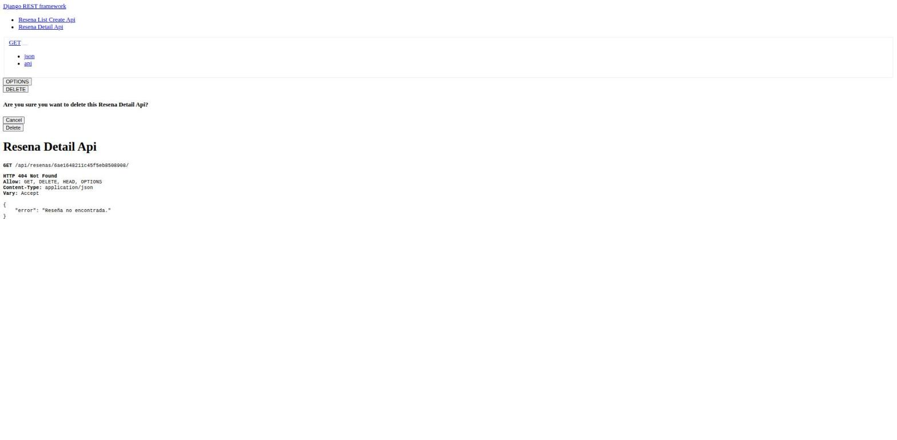

Administrador ve la reseña de A → 200:
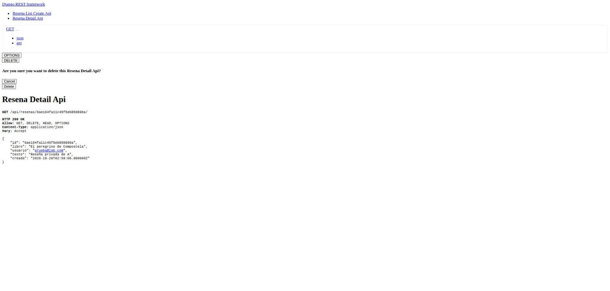

## Parte 4 — XSS

- **Dónde:** el proyecto no tenía texto libre, así que se usaron las **reseñas** de la Parte 3, que se muestran en la página de cada libro.
- **Ataque:** primero se mostró la reseña con `dangerouslySetInnerHTML` y se publicó ``. Apareció la alerta: **XSS almacenado** (A05).
- **Corrección:** la reseña se muestra como texto (`
{r.texto}
`). React escapa el contenido y se ve el texto literal.
- **Refuerzo con CSP:** el frontend (Next) envía una `Content-Security-Policy` con un *nonce* distinto en cada petición (`src/proxy.ts`), además de `X-Content-Type-Options: nosniff` y `X-Frame-Options: DENY`. El backend también envía su CSP (`cuentas/middleware.py`).
- **Defensa en profundidad:** con la CSP activa se volvió a poner temporalmente el código vulnerable. La alerta ya no apareció: el navegador bloqueó el `onerror` en línea y lo reportó en la consola. Después se restauró la corrección.

| Prueba | Resultado |
|---|---|
| Código vulnerable sin CSP | Se ejecuta `alert('XSS')` |
| Código corregido | Se ve el texto literal, sin alerta |
| Código vulnerable con CSP | Sin alerta; error de CSP en la consola |

**Evidencias**

XSS almacenado antes de corregir:
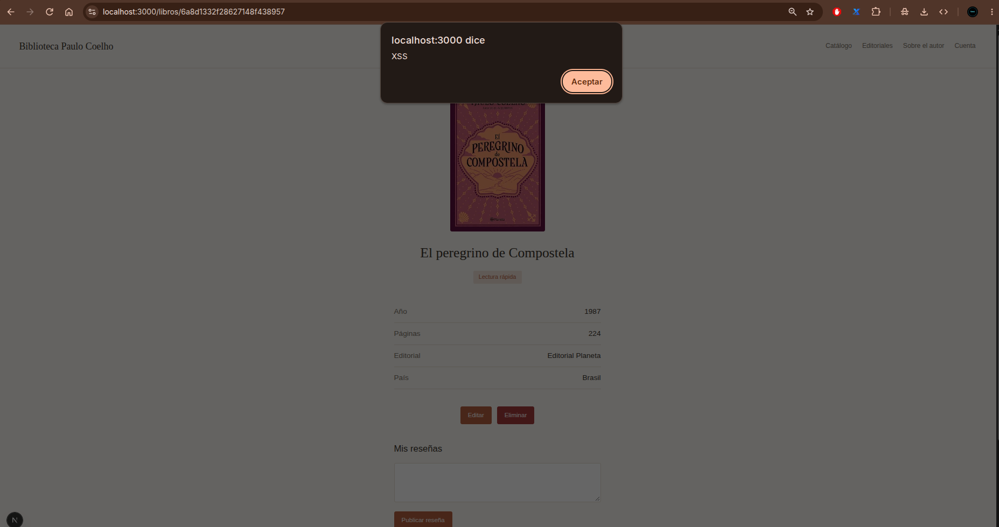

Después de corregir, la reseña se ve como texto:
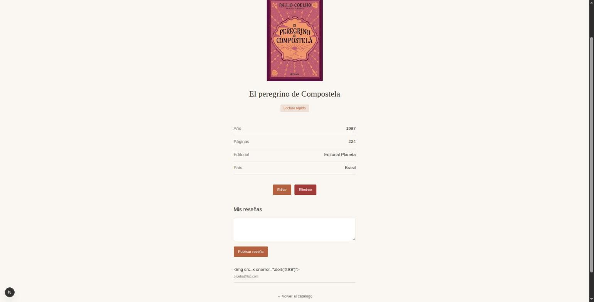

La CSP bloquea el `onerror` aunque el código sea vulnerable:
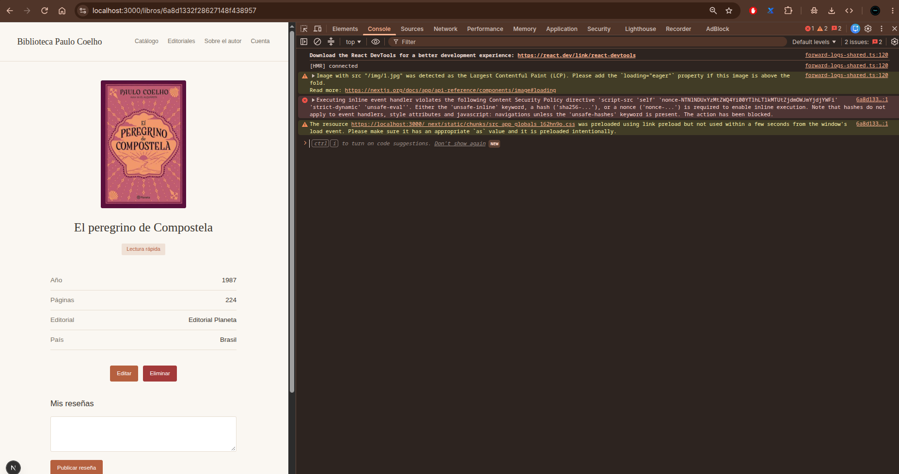

Cabeceras de seguridad en la respuesta:
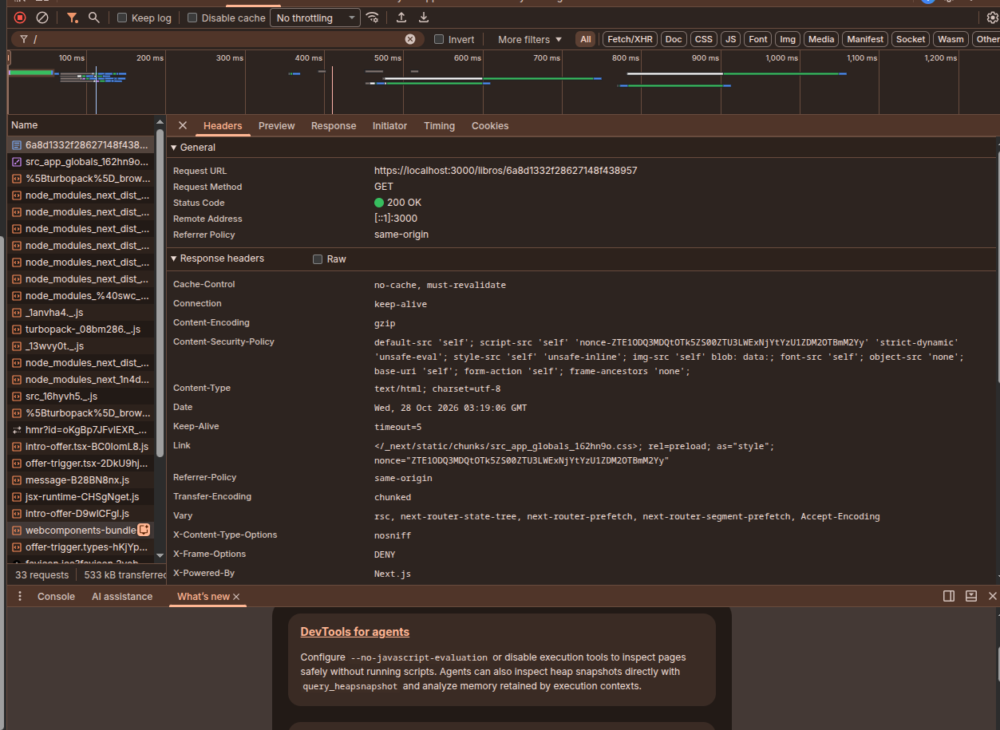
